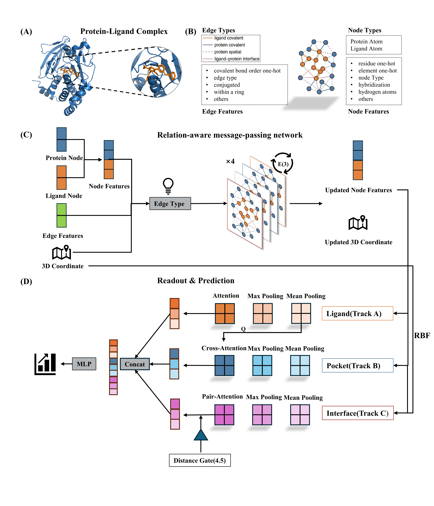

# LICA

LICA predicts protein–ligand binding affinity (pK) from a complex graph. The test split is CASF-2016.



## Environment

```bash
conda env create -f environment.yaml
conda activate lica-egnn
```

This environment is Python 3.10, PyTorch 2.4.0+cu124, and PyTorch Geometric 2.7.0. PDBbind structures and checkpoints are not included. Place PDBbind v2020 under `data/raw/PDBbind_v2020/` with `refined-set/`, `general-set/`, and `index/`.

## Data

Training data come from PDBbind version 2020 (the refined set and the general set). The database is [PDBbind+](https://www.pdbbind-plus.org.cn/), and version 2020 is available on its [download page](https://www.pdbbind-plus.org.cn/download).

Run the three scripts below from `src/preprocess`, in this order. `curate_pdbbind.py` finds `data/` relative to that directory.

```bash
cd src/preprocess
python curate_pdbbind.py
python compute_pairwise_tanimoto.py \
  --root_dir ../../data/curated_pdbbind \
  --index_file ../../data/curated_pdbbind/curated_indices.csv \
  --save_dir ../../data/similarity/pairwise_similarity_matrix
python cluster_based_split.py
```

`curate_pdbbind.py` removes affinities written with `<`, `>`, or `~`, then keeps complexes with resolution at most 3.0 Å, an RDKit-readable ligand, at least 5 heavy atoms, and molecular weight at least 100 Da.

`compute_pairwise_tanimoto.py` writes the ECFP6 Tanimoto matrix.

`cluster_based_split.py` links ligands with Tanimoto similarity of at least 0.75 and holds out every cluster that contains a CASF-2016 complex. Set `SIM_DIR` at the top of that file to your `data/similarity` directory before running it. Point `paths` in `configs/train_config.yaml` at the curated structures, the affinity dictionary, and the split JSON you will train on.

## Training

From the repository root:

```bash
python src/train.py --config configs/train_config.yaml
```

Training builds the graphs, runs three seeds, and writes test metrics under the checkpoint directory in the config. Ablation configs in `configs/ablation/` use the same command. Score saved checkpoints with:

```bash
python src/evaluate.py --config configs/train_config.yaml
```
